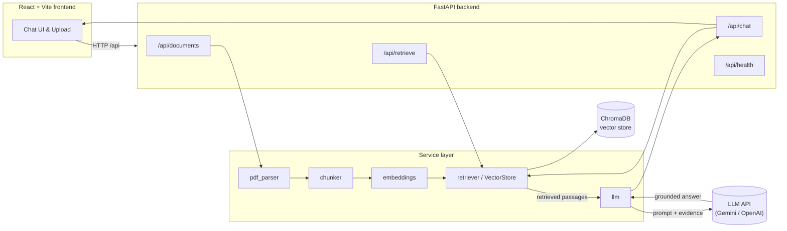
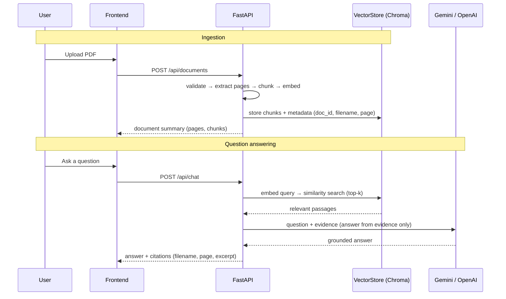

# DocuMind AI — AI-Powered Document Intelligence Platform

Upload PDFs, ask natural-language questions, and get **evidence-based answers
with page-level citations** — powered by a real Retrieval-Augmented Generation
(RAG) pipeline, not by stuffing an entire PDF into an LLM prompt.

> **Portfolio prototype.** This is a single-user demonstration project, not a
> production, multi-tenant, or security-hardened system. See
> [Security considerations & limitations](#security-considerations--known-limitations).

---

## Table of contents

- [Problem statement](#problem-statement)
- [Features](#features)
- [Architecture](#architecture)
- [RAG pipeline](#rag-pipeline-how-it-actually-works)
- [Technology stack](#technology-stack)
- [Project structure](#project-structure)
- [Setup (WSL Ubuntu)](#setup-wsl-ubuntu)
- [Running the app](#running-the-app)
- [API documentation](#api-documentation)
- [Embeddings backends](#embeddings-backends)
- [Testing](#testing)
- [Evaluation](#evaluation)
- [CI/CD (GitHub Actions)](#cicd-github-actions)
- [Security considerations & known limitations](#security-considerations--known-limitations)
- [Design decisions](#design-decisions-for-interview-discussion)
- [Future improvements](#future-improvements)

---

## Problem statement

Reading long PDFs to find one fact is slow, and asking a general chatbot about a
document is unreliable — it hallucinates, cannot cite a source, and has no access
to *your* files. DocuMind AI solves this by retrieving the most relevant passages
from the user's own documents first, then asking the LLM to answer **using only
that retrieved evidence**, returning citations to the exact page so answers are
verifiable.

## Features

- 📄 **PDF upload** with drag-and-drop, validated by extension, declared type,
  size, and whether the bytes actually parse as a PDF.
- ✂️ **Page-aware extraction & chunking** — every chunk remembers its page number.
- 🔎 **Semantic retrieval** over a ChromaDB vector store.
- 🤖 **Grounded answer generation** — the LLM answers *only* from retrieved
  evidence and is instructed never to invent facts or citations.
- 📌 **Citations** with filename, page number, and the supporting excerpt.
- 🗂️ **Document management** — list, scope questions to selected documents, and
  delete (which also removes the document's vectors).
- 🧪 **Retrieval-only diagnostic mode** (`/api/retrieve`) that works with no API key.
- 🧰 **Lightweight offline embedding backend** so the pipeline runs even where the
  ML stack can't be installed.
- ✅ **Automated tests** (mocked LLM, no paid key needed) and **GitHub Actions CI**.

## Architecture



### Ingestion vs. query



## RAG pipeline (how it actually works)

```
PDF → Text extraction → Chunking → Embeddings → ChromaDB
                                                    │
                        Question ──► embed ──► similarity search (top-k)
                                                    │
                                            retrieved passages
                                                    │
                            prompt(question + evidence only) ──► LLM
                                                    │
                                     answer + citations (page-level)
```

Key properties:

1. The LLM **never** receives the whole PDF — only the top-k retrieved passages.
2. Retrieval is **separate from generation** (`/api/retrieve` vs `/api/chat`) so
   the retrieval quality can be tested on its own.
3. If no relevant passage is found, the API returns *"The documents do not
   contain enough information to answer this question."* instead of guessing.
4. Deleting a document removes its vectors, and questions can be **scoped** to
   chosen documents so answers never leak across unrelated uploads.

## Technology stack

| Layer      | Technology |
|------------|------------|
| Frontend   | React 18, Vite, Tailwind CSS |
| Backend    | Python, FastAPI, Pydantic |
| PDF        | pypdf |
| Embeddings | sentence-transformers (`all-MiniLM-L6-v2`) + a hashing fallback |
| Vector DB  | ChromaDB (cosine similarity) |
| LLM        | Pluggable: **Google Gemini** (free tier, default) or OpenAI |
| Testing    | pytest, httpx, ruff |
| CI/CD      | GitHub Actions |

## Project structure

```
documind-ai/
├── backend/
│   ├── app/
│   │   ├── main.py            # FastAPI app + /api/health
│   │   ├── config.py          # env-based settings (pydantic-settings)
│   │   ├── deps.py            # DI container (embedder, store, llm)
│   │   ├── logging_config.py
│   │   ├── routes/
│   │   │   ├── documents.py   # upload / list / delete
│   │   │   └── chat.py        # /retrieve and /chat
│   │   ├── services/
│   │   │   ├── pdf_parser.py  # validation + page-aware extraction
│   │   │   ├── chunker.py     # overlapping chunks w/ page metadata
│   │   │   ├── embeddings.py  # sentence-transformers | hashing
│   │   │   ├── retriever.py   # ChromaDB vector store + registry
│   │   │   └── llm.py         # grounded answer generation
│   │   └── schemas/           # Pydantic request/response models
│   ├── eval/                  # reproducible retrieval evaluation
│   ├── tests/                 # pytest suite (mocked LLM)
│   ├── requirements.txt       # full runtime (incl. ML stack)
│   ├── requirements-dev.txt   # CI/test deps (no torch)
│   └── pyproject.toml         # pytest + ruff config
├── frontend/
│   ├── src/
│   │   ├── App.jsx
│   │   ├── components/        # Sidebar, Chat, icons
│   │   └── services/api.js
│   └── package.json
├── .github/workflows/ci.yml
├── .env.example
├── .gitignore
└── README.md
```

## Setup (WSL Ubuntu)

> Verified on Ubuntu 26.04 with **Python 3.14** and Node 20+. The pinned
> dependencies all ship Python 3.14 (`cp314`) wheels; they also work on 3.11–3.13,
> which is what CI uses.

> ⚠️ **WSL performance tip (important).** If your project lives under
> `/mnt/c`, `/mnt/d`, … that is the **Windows filesystem**, where I/O is ~10–50×
> slower. Installing a Python venv or `node_modules` there can take *30+ minutes*.
> Put the **virtual environment on the native Linux filesystem** (e.g.
> `~/documind-venv`) — or, better, keep the whole project under your Linux home
> (`~/`). The commands below create the venv outside the project for this reason.

```bash
# 1. Clone and enter the project
git clone <your-repo-url> documind-ai && cd documind-ai

# 2. Backend virtual environment
#    Create it on the NATIVE Linux filesystem for speed (see tip above):
python3 -m venv ~/documind-venv
source ~/documind-venv/bin/activate
cd backend

# 3. Install backend dependencies
#    Full stack (real semantic embeddings; downloads a model on first use):
pip install -r requirements.txt
#    OR lightweight (no torch; use with EMBEDDING_BACKEND=hash):
#    pip install -r requirements-dev.txt

# 4. Configure environment
cp ../.env.example .env
#   Edit .env and set GOOGLE_API_KEY (free Gemini) to enable answer generation.
#   Retrieval and the test suite work WITHOUT a key.
```

Frontend:

```bash
cd ../frontend
npm install
```

### Environment variables

See [`.env.example`](.env.example). The most important:

| Variable | Default | Purpose |
|----------|---------|---------|
| `LLM_PROVIDER` | `gemini` | `gemini` (free tier) or `openai`. |
| `GOOGLE_API_KEY` | _(none)_ | Enables Gemini answers. Free key: <https://aistudio.google.com/apikey>. Without it, chat returns a transparent retrieval-only response. |
| `GEMINI_MODEL` | `gemini-3.1-flash-lite` | Gemini model. |
| `OPENAI_API_KEY` / `OPENAI_MODEL` | _(none)_ / `gpt-4o-mini` | Only used when `LLM_PROVIDER=openai`. |
| `EMBEDDING_BACKEND` | `sentence_transformers` | `hash` for a lightweight offline run. |
| `CHUNK_SIZE` / `CHUNK_OVERLAP` | `800` / `150` | Characters per chunk / overlap. |
| `RETRIEVAL_TOP_K` | `5` | Passages retrieved per question. |
| `MAX_UPLOAD_MB` | `10` | Upload size limit. |
| `CORS_ORIGINS` | `http://localhost:5173,...` | Allowed frontend origins. |

## Running the app

**Terminal 1 — backend** (from `backend/`, venv active):

```bash
uvicorn app.main:app --reload --port 8000
```

- API: <http://localhost:8000>
- Interactive docs (Swagger): <http://localhost:8000/docs>

**Terminal 2 — frontend** (from `frontend/`):

```bash
npm run dev
```

- App: <http://localhost:5173> (Vite proxies `/api` to the backend)

## API documentation

| Method | Path | Description |
|--------|------|-------------|
| `GET`  | `/api/health` | Health + whether the LLM is enabled and how many docs are indexed. |
| `POST` | `/api/documents` | Upload & process a PDF (`multipart/form-data`, field `file`). |
| `GET`  | `/api/documents` | List processed documents. |
| `DELETE` | `/api/documents/{document_id}` | Delete a document and its vectors. |
| `POST` | `/api/retrieve` | Semantic search only — returns passages, no LLM call. |
| `POST` | `/api/chat` | Full RAG — retrieve evidence then generate a cited answer. |

Example:

```bash
# Upload
curl -F "file=@mydoc.pdf" http://localhost:8000/api/documents

# Retrieve passages only (no API key needed)
curl -X POST http://localhost:8000/api/retrieve \
  -H "Content-Type: application/json" \
  -d '{"query": "What is the refund policy?", "top_k": 3}'

# Ask a question (needs GOOGLE_API_KEY / free Gemini for a synthesised answer)
curl -X POST http://localhost:8000/api/chat \
  -H "Content-Type: application/json" \
  -d '{"query": "What is the refund policy?"}'
```

## Embeddings backends

| Backend | Quality | Needs | When to use |
|---------|---------|-------|-------------|
| `sentence_transformers` (default) | Real semantic similarity | `pip install -r requirements.txt` (torch) | Normal use. |
| `hash` | Literal word-overlap only | Nothing extra | Fast offline demo / CI / tests. |

Set via `EMBEDDING_BACKEND` in `.env`. The hashing backend is **not** a semantic
model — it exists so the retrieval *plumbing* can run and be tested anywhere.

## Testing

From `backend/` with the dev deps installed (`pip install -r requirements-dev.txt`):

```bash
pytest                       # run the suite
pytest --cov=app             # with coverage
```

The suite uses the deterministic `hash` embedder and an in-memory ChromaDB, and
**mocks the LLM call**, so it runs fast, offline, and needs no API key. It
covers PDF extraction, chunking + page metadata, empty/malformed PDF handling,
request validation, upload/list/delete, retrieval relevance, document isolation,
insufficient-evidence behavior, and chat error handling when the key is missing.

## Evaluation

A small, reproducible retrieval evaluation lives in `backend/eval/`:

```bash
cd backend
python eval/run_eval.py                                  # hash backend (offline)
EMBEDDING_BACKEND=sentence_transformers python eval/run_eval.py   # semantic
```

It reports **measured** (never fabricated) numbers: retrieval hit@k against the
expected page, keyword coverage, and whether genuinely unanswerable questions are
correctly flagged as low-confidence. The corpus and questions are in
`eval/dataset.json`.

## CI/CD (GitHub Actions)

[`.github/workflows/ci.yml`](.github/workflows/ci.yml) runs on every push and PR:

- **Backend job** — sets up Python 3.12, installs `requirements-dev.txt`, runs
  `ruff` lint, then `pytest` with coverage. (It installs the no-torch dev deps
  because the tests inject a lightweight embedder — this keeps CI fast and avoids
  multi-GB ML downloads.)
- **Frontend job** — sets up Node 20, installs deps, and runs `npm run build`.

The build fails if lint, tests, or the frontend build fail.

## Security considerations & known limitations

Implemented for this prototype:

- All inputs validated server-side with Pydantic; upload size and type restricted.
- Internal document IDs are generated server-side (`uuid4`) — filenames are never
  trusted for storage identity, preventing path traversal.
- Uploads are validated from **bytes**, not written to disk before checking.
- Secrets live only in environment variables and are never logged or sent to the
  frontend; error responses avoid leaking stack traces or credentials.
- The LLM call has a timeout and degrades gracefully on failure.
- CORS is restricted to the configured dev origins.

**This is NOT:** a multi-user/multi-tenant system, authenticated, rate-limited,
or audited for production. There is no access control between documents beyond
the single-process store. Do not upload confidential data. There is **no OCR** —
scanned/image-only PDFs with no text layer are rejected with a clear message.
No "enterprise-grade security" or biometric claims are made.

## Design decisions (for interview discussion)

- **Why chunk per page?** It keeps citation page numbers exact. The trade-off is
  that context spanning a page boundary isn't merged — acceptable for an MVP.
- **Why cosine similarity + normalized embeddings?** Stable, scale-invariant
  similarity; scores map cleanly to `[0, 1]`.
- **Why a pluggable embedder?** It lets the whole retrieval pipeline be tested
  offline and deterministically, and gives a documented fallback when the ML
  stack can't be installed (e.g. bleeding-edge Python versions).
- **Why separate `/retrieve` and `/chat`?** Retrieval quality is the foundation
  of RAG; isolating it makes it independently testable and debuggable.
- **Why degrade instead of fail when the key is missing?** So the retrieval
  system is demonstrable without a paid key, and answers are never faked.

## Future improvements

- Cross-page / semantic chunking and a reranking step.
- Streaming answers (Server-Sent Events) for faster perceived latency.
- OCR fallback for scanned PDFs (e.g. Tesseract).
- Per-user auth and persistent, isolated collections.
- Hybrid search (keyword + vector) and evaluation on a larger labelled set.
```
